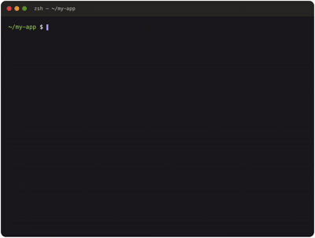

<p align="center">
  
</p>

<h1 align="center">LazyFinger</h1>

<p align="center">
  <strong>You type less. It fixes more.</strong><br>
  Run any project. Fix any failing command. Every change shown as a diff first.
</p>

<p align="center">
  <a href="https://github.com/himanshupphp/lazyfinger/releases"></a>
  
  <a href="LICENSE"></a>
</p>

```bash
lazy run              # install, set up, start, and watch any project
lazy npm run build    # or put it in front of any command to fix it when it fails
```

<p align="center">
  
</p>

- **Works with any command:** npm, composer, artisan, pytest, cargo, go, gradle, make, your own scripts.
- **Runs any project:** detects the stack, installs what's missing, fills in `.env`, starts the database, starts the app, and opens it in your browser.
- **Uses any model:** local with Ollama or LM Studio, or Claude, OpenAI, OpenRouter, or any OpenAI-compatible server.
- **Remembers:** every fix is journaled per project, so a different model or a later run never repeats a dead end.
- **Keeps you in control:** every change is shown as a diff first, and `lazy undo` reverts it.
- **Right-click ready:** "Run with LazyFinger" in Finder, Explorer, and Linux file managers.
- **Runs everywhere:** macOS, Windows, and Linux, as a single binary with no dependencies.

---

## Install

| System | Command |
|---|---|
| macOS (Homebrew) | `brew install --cask himanshupphp/tap/lazy` |
| macOS / Linux | `curl -fsSL https://raw.githubusercontent.com/himanshupphp/lazyfinger/main/install.sh \| sh` |
| Ubuntu / Debian | Download the `.deb` from [Releases](https://github.com/himanshupphp/lazyfinger/releases), then `sudo apt install ./lazy_*_linux_amd64.deb` |
| Windows (Scoop) | `scoop bucket add lazyfinger https://github.com/himanshupphp/scoop-bucket` then `scoop install lazy` |
| Windows (manual) | Download the zip from [Releases](https://github.com/himanshupphp/lazyfinger/releases) and put `lazy.exe` in a folder on your PATH |
| Go | `go install github.com/himanshupphp/lazyfinger/cmd/lazy@latest` |

Check it worked with `lazy --version`.

## Quick start

**1. Choose a model.** This opens a visual configurator in your browser:

```bash
lazy setup
```

LazyFinger finds Ollama or LM Studio if they're running and lists your installed models. You can add cloud providers, and their API keys go into your system keychain. Every connection is tested before saving.

**2. Run a project, or put `lazy` in front of a command:**

```bash
lazy run                   # start the project in this folder
lazy npm run build         # fix a failing build
lazy php artisan test      # fix failing tests
lazy --auto cargo build    # apply safe fixes without asking
```

**3. Optional: add the right-click menu:**

```bash
lazy integrate
```

When a command succeeds, LazyFinger stays out of the way. When it fails, LazyFinger explains the problem and proposes a fix:

```
 lazy  Command failed (exit 1) · attempt 1 of 3
╭──────────────────────────────────────────────────────────╮
│ Diagnosis                                                │
│ The script prints "totl", which is a typo of the         │
│ variable "total" declared on line 1.                     │
╰──────────────────────────────────────────────────────────╯
--- a/index.js
+++ b/index.js
@@ -1,4 +1,4 @@
 const total = add(2, 3);
-console.log(totl);
+console.log(total);

Apply this fix?  [a] apply  [e] edit  [r] retry with a hint  [s] skip ›
```

| Key | What it does |
|---|---|
| `a` | Apply the fix and re-run the command |
| `e` | Open the fix in your editor, then review the result again |
| `r` | Tell the model what it got wrong and get a new fix |
| `s` | Skip; nothing is changed |

---

## Run any project

```bash
lazy run                 # in the project folder
lazy run ~/code/my-app   # or point it at one
```

LazyFinger works out what kind of project it is and shows a plan before running anything:

```
╭────────────────────────────────────────────────────────────────╮
│ Laravel 11 project                                             │
│ 1. create .env from .env.example, 2 value(s) for you to fill in│
│ 2. make sure MySQL is running at 127.0.0.1:3306 (from .env)    │
│ 3. composer install  — install PHP dependencies                │
│ 4. npm install  — install JavaScript dependencies              │
│ 5. php artisan key:generate  — set the app key                 │
│ 6. php artisan migrate  — set up the database (asks first)     │
│ 7. php artisan serve  — start the app                          │
╰────────────────────────────────────────────────────────────────╯
  ✓ PHP 8.3.4
  ✓ Composer 2.8.1
  ! Node.js isn't installed
Run this plan?  [y] yes  [n] no ›
```

Then it works through the plan:

1. **Checks prerequisites, and installs what's missing.** It reads required versions from `composer.json`, `engines`, `.nvmrc`, `.python-version`, `.ruby-version`, `go.mod`, and similar files. Missing tools are installed with your package manager:
   - Homebrew on macOS (LazyFinger can install Homebrew too)
   - winget on Windows
   - apt, dnf, or pacman on Linux

   You always see the exact commands first and confirm them.
2. **Fills in `.env`.** It creates `.env` from `.env.example` and asks for empty values, using the example's comments as descriptions and hiding secrets as you type. It also offers to add `.env` to `.gitignore`.
3. **Starts the databases it needs.** It reads which databases and caches the project expects (PostgreSQL, MySQL, MariaDB, Redis, MongoDB) from `.env`, `DATABASE_URL`, Spring config, and Docker Compose, and checks that they're answering. If one isn't, you choose how to start it:
   - the project's own Compose service
   - a Docker container using your `.env` settings, reachable only from this computer
   - a native install
4. **Installs and sets up.** Each step runs through LazyFinger, so failures are diagnosed and fixed as usual. Steps that change your database always ask first.
5. **Starts the app and opens it** in your browser once it actually answers.
6. **Watches the running app.** It notices errors in the output (and in `storage/logs` for Laravel). Press Ctrl-C and LazyFinger offers to fix what it saw, then restarts the app. Crashes are handled the same way. If the port is taken, it shows which program holds it and offers the next free one.

| Flag | |
|---|---|
| `--no-open` | Don't open the browser when the app is ready |
| `--yes` | Accept the plan without asking (database steps still ask) |
| `--auto` | Apply safe fixes without asking |
| `--provider NAME` | Start with a specific provider |

## Right-click menu

```bash
lazy integrate            # add "Run with LazyFinger" to your file manager
lazy integrate --status
lazy integrate --remove
```

| System | Where to find it |
|---|---|
| macOS | Finder → right-click a folder → Quick Actions → Run with LazyFinger |
| Windows | Explorer → right-click a folder, or empty space inside one → Run with LazyFinger (on Windows 11, under "Show more options") |
| Linux | GNOME Files and Caja (under Scripts), Nemo, and Dolphin |

It opens a terminal running `lazy run` in that folder, and the window stays open when it finishes so you can read the result.

---

## Supported languages and frameworks

LazyFinger works with any command in any language. It also understands the errors, project files, and package registries of these:

| Stack | `lazy run` detects | Project files read | Package installs verified on |
|---|---|---|---|
| PHP | Laravel, Symfony, plain PHP | `composer.json`, `.env` variable names | Packagist |
| JavaScript / TypeScript | Next.js, Vite, Nuxt, SvelteKit, Angular, Express, Node | `package.json`, lockfiles | npm |
| Python | Django, FastAPI, Flask, scripts | `pyproject.toml`, `requirements.txt`, `Pipfile` | PyPI |
| Ruby | Rails | `Gemfile` | RubyGems |
| Java / Kotlin | Spring Boot (Maven or Gradle) | `pom.xml`, `build.gradle(.kts)` | always asks |
| C# / .NET | `dotnet run` projects | `*.csproj`, `*.fsproj`, `*.sln` | NuGet |
| Go | `go run` projects | `go.mod` | always asks |
| Rust | `cargo run` projects | `Cargo.toml` | crates.io |
| Dart / Flutter | Flutter apps | `pubspec.yaml` | pub.dev |
| Other | Docker Compose, static sites | `mix.exs`, `Package.swift`, `CMakeLists.txt`, `Makefile` | always asks |

For projects LazyFinger doesn't recognize, your model reads the README and file layout and proposes the steps. You review them before anything runs. Unsafe suggestions like `sudo`, `rm -rf`, and `curl | sh` are dropped.

### Laravel

```bash
lazy run
lazy composer install
lazy php artisan migrate
lazy php artisan test
```

Laravel-specific behavior:
- LazyFinger reads the latest error from `storage/logs/laravel.log`.
- It maps compiled Blade views back to your templates.
- It works with Sail and Docker paths.
- It knows the usual fixes: `composer install`, creating `.env`, `php artisan key:generate`, and `php artisan optimize:clear`.
- If MySQL or PostgreSQL isn't running, it can start one in Docker using your `.env` credentials.

LazyFinger never edits `.env` or `vendor/`. If your database settings are wrong, it tells you which variables to set. Destructive commands like `migrate:fresh` and `db:wipe` are never proposed.

---

## Modes

| Mode | How to use it | Behavior |
|---|---|---|
| **Analyze** (default) | `lazy ...` or `--review` | Explains every fix and waits for your approval |
| **Autofix** | `lazy --auto ...` | Applies dependency installs, safe maintenance commands, and code edits automatically, then shows a summary |

Even in Autofix, these always wait for you:
- installing packages that can't be verified or have very few downloads
- installs from URLs, git repos, or local paths, and global installs
- installing tools or databases on your computer
- database migrations, and anything that could delete data
- chained or redirected shell commands

If a fix doesn't change the error, Autofix switches back to Analyze for that issue.

---

## Memory and model fallback

LazyFinger keeps a journal of every fix in `.lazyfinger/journal.jsonl`: the error, which model proposed what, what you decided, and what happened next. When an error comes back, the earlier attempts are shared with the model, so it builds on what was learned instead of repeating dead ends.

```bash
lazy history          # the last 5 sessions as a tree
lazy history --all
```

```
● Oct 29 15:40  lazy php artisan test
  └─ SQLSTATE[HY000] [2002] Connection refused
     ├─ claude: Database isn't running; set DB_HOST → skipped
     ├─ switched: claude → local (ran out of credits or quota)
     └─ local: Use sqlite for tests in phpunit.xml (phpunit.xml) → applied → fixed
```

If a provider runs out of quota, is rate limited, is overloaded, or can't be reached, LazyFinger switches to another one mid-fix and carries over everything tried so far. To switch automatically, set an order in your config:

```toml
fallback = ["local"]
```

Without it, LazyFinger asks before switching. Exhausted providers are paused for up to an hour so they aren't retried in vain; the pause clears as soon as the provider works again.

## Undo

Every file change is snapshotted before it's written.

```bash
lazy undo     # revert the most recent fix; run again to step further back
```

Snapshots and the journal live in `.lazyfinger/` in your project, which git ignores automatically.

---

## Safety and privacy

- **Local models keep everything on your machine.** With Ollama or LM Studio, no code leaves your computer.
- **Cloud providers ask once.** The first time you use one, LazyFinger tells you what will be sent: the error output and the relevant source files.
- **Secrets stay out.**
  - `.env` files are never sent; only variable names are, never values.
  - Obvious tokens and passwords in logs are redacted.
  - Values you type into the `.env` form never leave your computer.
- **API keys are kept out of config files.** `lazy setup` stores them in your system keychain: macOS Keychain, Windows Credential Manager, or the Linux Secret Service.
- **Packages are checked before installing.** Proposed installs are looked up on their registry, so a hallucinated or typo-squatted name can't be installed silently.
- **Nothing is installed without asking.** Tool, database, and Docker installs always show the exact commands and wait for your confirmation. Passwords are masked in every command shown.
- **Databases stay private.** Containers started by LazyFinger listen only on `127.0.0.1`.
- **Edits stay inside your project.** LazyFinger never touches `.git`, `node_modules`, `vendor`, `.env`, lockfiles, or framework caches.
- **Running a project is your call.** `lazy run` shows every command before running it. Only run projects from sources you trust.
- **Cloned repos can't hijack your setup.** A project's `.lazyfinger.toml` can only choose among your own providers. It can't add providers, change fallbacks, or turn on Autofix.

---

## Configuration

`lazy setup` is the easiest way to configure LazyFinger. The config file lives at:
- macOS / Linux: `~/.config/lazyfinger/config.toml`
- Windows: `%AppData%\lazyfinger\config.toml`

```toml
mode = "analyze"          # or "autofix"
default = "claude"
max_attempts = 3
fallback = ["local"]      # switch here automatically when claude is exhausted

[providers.local]         # any OpenAI-compatible server
type = "openai"
base_url = "http://localhost:11434/v1"
model = "qwen2.5-coder:7b"

[providers.claude]
type = "anthropic"
model = "claude-sonnet-5-5"
```

### Commands and flags

| Command or flag | What it does |
|---|---|
| `lazy <command...>` | Run a command and fix it if it fails |
| `lazy run [folder]` | Install, set up, start, and watch a project |
| `lazy setup` | Open the visual configurator |
| `lazy integrate [--status \| --remove]` | Manage the right-click menu |
| `lazy history [--all]` | Show what LazyFinger tried in this project |
| `lazy undo` | Revert the most recent fix |
| `lazy config` | Show or create the config file |
| `--auto` / `--review` | Override the mode for this run |
| `--provider NAME` | Start with a specific provider |
| `--max-attempts N` | Number of fix attempts (default 3) |
| `--version` | Print the version |

---

## Troubleshooting

**"couldn't reach http://localhost:11434"**
Your local model server isn't running. Start Ollama (`ollama serve`) or LM Studio, then run `lazy setup` to check.

**"ran out of credits or quota"**
Add a fallback provider with `fallback = ["local"]`, or top up your account. `lazy history` shows when a paused provider becomes available again.

**`lazy` runs an older version**
You may have more than one copy installed. `which -a lazy` lists them; remove the old one, then run `hash -r`. If you use the right-click menu, run `lazy integrate` again afterwards.

**macOS: "lazy can't be opened because Apple cannot check it"**
This happens when the binary was downloaded through a browser. Run `xattr -d com.apple.quarantine $(which lazy)`, or install with Homebrew or the install script.

**macOS: "Run with LazyFinger" doesn't appear in Finder**
Turn it on in System Settings → Keyboard → Keyboard Shortcuts → Services → Files and Folders.

**Windows: "Windows protected your PC"**
Click **More info → Run anyway**, or install with Scoop.

**A tool was just installed but LazyFinger can't find it**
Open a new terminal and run `lazy run` again. On Windows, LazyFinger reloads PATH itself after winget installs.

**Docker is installed but "not running"**
Open Docker Desktop, or let LazyFinger start it. On Linux, if your user can't use Docker, run `sudo usermod -aG docker $USER`, then log out and back in.

**Linux servers: "couldn't save the key to your system keychain"**
Headless machines usually have no keyring. In `lazy setup`, open **Advanced** and enter an environment variable name, then `export` the key in your shell profile.

**`lazy run` picked the wrong command**
Run the right command through LazyFinger directly instead, e.g. `lazy npm run start`. Please also open an issue with your project type so detection can be improved.

**Fixes look wrong**
Smaller local models struggle with larger projects. Press `r` to give a hint, or try a stronger model with `--provider`.

---

## Build from source

Requires a recent version of [Go](https://go.dev/dl/).

```bash
git clone https://github.com/himanshupphp/lazyfinger.git
cd lazyfinger
go build -o lazy ./cmd/lazy
./lazy --version
```

To build every platform at once, run `./scripts/build.sh` on macOS/Linux or `.\scripts\build.ps1` on Windows. The results go to `dist/`.

### Releasing

Releases are automated with GoReleaser. Push a version tag:

```bash
git tag v1.0.0 && git push origin v1.0.0
```

GitHub Actions then builds all platforms, publishes the release, and updates the Homebrew cask and the Scoop manifest.

### Project layout

```
cmd/lazy/            CLI entry point
internal/heal/       the fix loop, risk rules, approvals
internal/runapp/     lazy run: plan, prerequisites, .env, services, start and watch
internal/project/    project detection and version checks
internal/install/    installing tools and databases per OS
internal/services/   finding and starting databases and caches
internal/integrate/  right-click menu for macOS, Windows, Linux
internal/gather/     error context: logs, files, frameworks, redaction
internal/patch/      parsing and applying edits safely
internal/journal/    per-project memory and history
internal/provider/   model providers, fallback chain, quota handling
internal/registry/   package verification (npm, PyPI, Packagist, ...)
internal/setup/      the visual configurator
internal/runner/     PTY / ConPTY command runner
internal/envfile/    .env creation from examples
```

## Roadmap

- A desktop app for people who don't use the terminal
- Fallback order in `lazy setup`
- Signed and notarized binaries

## License

[MIT](LICENSE)
